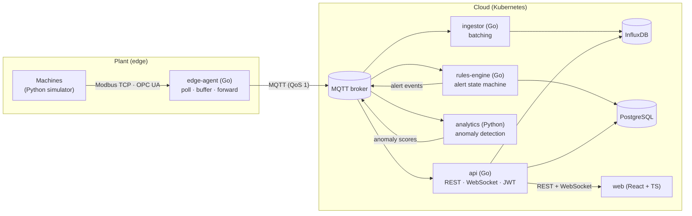

# Plantorq

[](https://github.com/OubeidHanini/plantorq/actions/workflows/ci.yml)


[](LICENSE)

**Cloud-native industrial monitoring platform.** A Go edge agent polls machines
over **Modbus TCP and OPC UA** and streams their measurements to a multi-tenant SaaS backend
that stores time series, evaluates alert rules, detects anomalies and pushes
everything live to a React dashboard.

> 🇩🇪 **Kurzfassung:** Plantorq ist eine Cloud-native IIoT-Monitoring-Plattform.
> Ein Edge-Agent in Go liest Maschinendaten per Modbus TCP und OPC UA und überträgt sie über
> MQTT – mit persistentem Offline-Puffer, damit bei Netzausfällen keine Messwerte
> verloren gehen. Im Backend (Go, hexagonale Architektur) werden Zeitreihen in
> InfluxDB, Mandanten, Regeln und Alarme in PostgreSQL gespeichert. Ein Python-Dienst
> erkennt Anomalien, ein React/TypeScript-Dashboard zeigt alles in Echtzeit.
> Bereitstellung mit Docker, Kubernetes (Kustomize) und einer CI/CD-Pipeline mit
> GitHub Actions inklusive End-to-End-Test auf einem kind-Cluster.

---

## Architecture



| Service | Language | Responsibility |
|---|---|---|
| `edge-agent` | Go | Polls each machine concurrently, decodes registers, publishes over MQTT, **stores and forwards** through a disk-backed queue when the broker is unreachable |
| `ingestor` | Go | Consumes telemetry, writes it to InfluxDB in batches, retries with backoff, scales out through an MQTT shared subscription |
| `rules-engine` | Go | Evaluates tenant rules with a pending → firing → resolved **state machine**, persists alerts idempotently, publishes alert events |
| `api` | Go | Multi-tenant REST API with JWT and role-based access, live WebSocket fan-out, history queries |
| `analytics` | Python | Rolling z-score anomaly detection per machine, published back as an `anomaly_score` metric |
| `simulator` | Python | Simulated plant floor: CNC mills and compressor over Modbus TCP, welding robot over OPC UA |
| `web` | React + TypeScript | Dashboard: KPIs, trend charts with thresholds, machine fleet, live alerts, rule management |

## Engineering highlights

**Hexagonal architecture (ports & adapters).** Dependencies point inwards:
`adapters → app → domain`. The domain has no infrastructure imports, use cases
depend only on interfaces, and `cmd/*/main.go` is the only place where concrete
types are wired together.

```
internal/
├── domain/        # pure business logic: telemetry, alerting state machine, identity
├── app/           # use cases + their ports: collector, ingest, alerting, platform
├── adapters/      # modbus, mqtt, influx, postgres, bbolt, jwt, password, prom
├── transport/http # chi handlers, middleware, WebSocket hub
└── pkg/           # cross-cutting: config, logging, stats
```

**Design patterns where they solve a real problem**

| Pattern | Where | Why |
|---|---|---|
| Strategy | `collector.DeviceReader` (Modbus TCP, OPC UA), alert operators, Python `AnomalyDetector` and machine profiles | A new protocol or detector is a new type; nothing else changes |
| State | `domain/alerting.Evaluator` | Alert lifecycle with a `for` duration that suppresses one-off spikes |
| Store and forward | `collector.Forwarder` + bbolt queue | No data loss during network outages; order preserved on replay |
| Repository | `adapters/postgres` | SQL in one place; tenant scoping on every query |
| Observer | `transport/http.Hub` | Per-tenant WebSocket fan-out; slow clients never block others |
| Factory | `cmd/edge-agent/readers.go` | Protocol → reader registry (open/closed) |

**Reliability.** Exponential backoff with jitter for unreachable devices,
automatic MQTT reconnection with resubscription, non-blocking ingestion that
exposes overload as a metric instead of stalling the broker, graceful shutdown
that flushes in-flight batches, and a partial unique index that makes alert
creation idempotent across restarts.

**Security.** Tenant isolation enforced in the application layer (the tenant
always comes from the verified token, never from the request), role-based
authorisation, bcrypt passwords, HS256 JWTs with mandatory expiry, internal
errors never leaked to clients, WebSocket origin checks, non-root distroless
images with read-only filesystems.

**Observability.** Structured JSON logs (`slog`), Prometheus metrics on every
service (`/metrics`), liveness and readiness probes (`/healthz`, `/readyz`).
Use cases emit domain signals through a `Metrics` port; only the Prometheus
adapter knows about counters and histograms.

## Industrial protocols

The edge agent reads each machine through a `collector.DeviceReader`. Two
strategies exist, selected per machine in [agent.yaml](deploy/config/agent.yaml):

| Protocol | Adapter | Addressing | Notes |
|---|---|---|---|
| Modbus TCP | `internal/adapters/modbus` | holding registers, `raw * scale + offset` | all registers of a machine in one FC03 transaction |
| OPC UA | `internal/adapters/opcua` | typed node ids, e.g. `ns=2;s=robot-07.temperature` | all nodes in one Read call; security policy configurable (None in the demo, Basic256Sha256 in production) |

Adding OPC UA required **no change to the collector**: one adapter, one entry
in the protocol registry (`cmd/edge-agent/readers.go`), which bundles each
protocol's config validation with its reader construction. Malformed node ids
are rejected at startup instead of failing silently on every poll. CI runs the
Go OPC UA reader against the Python OPC UA simulator to prove interoperability.

## Observability: the platform monitors itself

Machine alerts are business rules evaluated by the rules engine. A second
layer, Prometheus + Grafana, watches the pipeline that produces them, so a
silent failure (broker down, ingestor dropping data, dead device) is caught
before it hides a real machine problem.

| Signal | Metric | Prometheus alert |
|---|---|---|
| Service health | `up` | `PlantorqServiceDown` |
| Broker link from the edge | `plantorq_agent_broker_connected` | `PlantorqEdgeBrokerDisconnected` |
| Offline buffer depth | `plantorq_agent_buffer_depth` | `PlantorqEdgeBufferGrowing` |
| Device polls, latency | `plantorq_agent_polls_total`, `plantorq_agent_poll_duration_seconds` | `PlantorqMachineUnreachable` |
| Ingestion written / dropped | `plantorq_ingestor_readings_*_total` | `PlantorqIngestorDroppingReadings` |
| Alert transitions | `plantorq_rules_alert_transitions_total` | |
| Anomaly scores | `plantorq_analytics_*` | |
| API latency per route | `plantorq_api_request_duration_seconds` | `PlantorqAPIHighLatency` |

The Grafana dashboard and datasource are **provisioned from Git**
([deploy/observability](deploy/observability)); UI edits are disabled so the
JSON in the repository is the single source of truth. In Kubernetes,
Prometheus discovers pods through their `prometheus.io/*` annotations using a
namespaced, read-only Role.

## Quick start

Requirements: Docker with Compose.

```bash
cp deploy/compose/.env.example deploy/compose/.env   # once; edit the secrets
docker compose -f deploy/compose/docker-compose.yml up --build
```

| URL | What |
|---|---|
| <http://localhost:3000> | Dashboard: sign in with `admin@acme.io` / the `SEED_DEMO_PASSWORD` from `.env` (also `operator@acme.io`, `viewer@acme.io` to see role restrictions) |
| <http://localhost:3001/d/plantorq-platform> | Grafana: platform health dashboard (anonymous read-only; sign in as `admin` / `GRAFANA_ADMIN_PASSWORD` to edit) |
| <http://localhost:9090> | Prometheus: targets, metrics, platform alerts |

What to expect: four machines report live data, `press-p04` is offline on
purpose, `cnc-02` overheats every few minutes and fires a critical alert that
resolves on its own, and the compressor's vibration spikes are flagged by the
anomaly service.

### Configuration

Every service is configured through environment variables (twelve-factor);
nothing secret is committed.

| Where | File | Committed? |
|---|---|---|
| Docker Compose | [`deploy/compose/.env.example`](deploy/compose/.env.example) → copy to `.env` | example only; `.env` is git-ignored |
| Kubernetes, non-secret | [`deploy/k8s/base/config.yaml`](deploy/k8s/base/config.yaml) (ConfigMap) | yes |
| Kubernetes, secrets | [`deploy/k8s/secrets.env.example`](deploy/k8s/secrets.env.example): keys of the `plantorq-secrets` Secret | example only; production uses a secret manager |
| kind / CI | [`deploy/k8s/overlays/kind/demo-secrets.env`](deploy/k8s/overlays/kind/demo-secrets.env) | yes, throwaway demo values |
| Edge agent devices | [`deploy/config/agent.yaml`](deploy/config/agent.yaml), `${VARS}` expanded from the environment | yes, no secrets |

Required secrets have no default: Compose refuses to start without them and
the API rejects a JWT key shorter than 32 bytes. In Kubernetes each workload
reads only the secret keys it needs (`secretKeyRef`, key by key), never the
whole Secret.

| Variable | Used by | Default |
|---|---|---|
| `DATABASE_URL` 🔒 | api, rules-engine | — |
| `JWT_SECRET` 🔒 | api | — (≥ 32 bytes) |
| `SEED_DEMO_PASSWORD` 🔒 | api | empty: no demo data |
| `MQTT_BROKER` | all except web | `tcp://localhost:1883` |
| `MQTT_USERNAME`, `MQTT_PASSWORD` 🔒 | edge-agent, ingestor, rules-engine, api, analytics | empty (anonymous) |
| `INFLUX_URL`, `INFLUX_DB` | ingestor, api | `http://localhost:8086`, `plantorq` |
| `JWT_TTL`, `CORS_ORIGINS` | api | `12h`, empty |
| `BATCH_SIZE`, `FLUSH_INTERVAL`, `QUEUE_SIZE` | ingestor | `500`, `1s`, `20000` |
| `RULE_RELOAD_INTERVAL` | rules-engine | `15s` |
| `AGENT_CONFIG`, `MODBUS_ADDRESS`, `OPCUA_ENDPOINT` | edge-agent | `/etc/plantorq/agent.yaml` |
| `WATCHED_METRICS`, `WINDOW`, `METRICS_PORT` | analytics | `vibration`, `120`, `9104` |
| `MODBUS_PORT`, `OPCUA_PORT`, `BIND_HOST` | simulator | `5020`, `4840`, `0.0.0.0` |
| `HTTP_ADDR`, `OPS_ADDR` | Go services | `:8080`; ops `:9100`–`:9103` |
| `LOG_LEVEL` | all | `info` (case-insensitive) |

🔒 = secret. `HOSTNAME` is set by Docker/Kubernetes and used as the MQTT
client id suffix.

### Kubernetes (kind)

```bash
kind create cluster --name plantorq
make kind-deploy
kubectl -n plantorq port-forward svc/web 8080:80
```

## Development

```bash
make test     # Go (race detector), Python, TypeScript
make lint     # gofmt, go vet, golangci-lint, ruff
```

| Area | Tests |
|---|---|
| Go | Table-driven unit tests per layer, fakes for every port, fuzzing of the register decoder, benchmarks, HTTP tests with `httptest` |
| Python | pytest for detectors, the analytics use case and machine profiles |
| Web | Strict TypeScript (`noUncheckedIndexedAccess`) |
| System | CI deploys the whole stack to a kind cluster and checks login and live data end to end |

## CI/CD

GitHub Actions runs on every push and pull request:

1. **Go**: formatting, `go vet`, golangci-lint, tests with the race detector and coverage
2. **Python**: ruff and pytest for both services
3. **Web**: type-check and production build
4. **OPC UA interop**: the Go reader reads the Python OPC UA simulator over a real connection
5. **Observability**: `promtool` validates Prometheus configs and alert rules; dashboard JSON is checked
6. **Images**: builds all seven images (pushed to GHCR on `main`)
7. **End to end**: deploys to a kind cluster with Kustomize and runs a smoke test

## Roadmap

- Per-tenant MQTT credentials and ACLs
- Tenant sharding for the rules engine

## License

[MIT](LICENSE)
